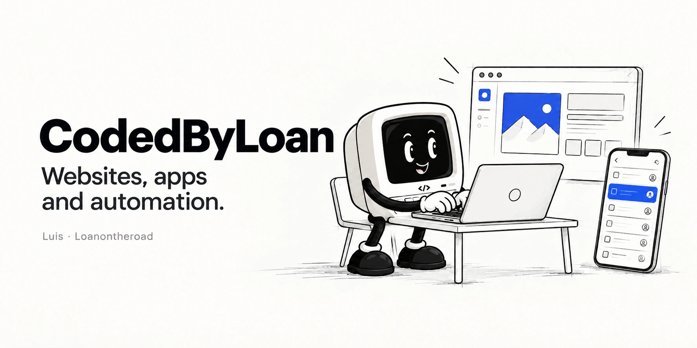

## Hi, I'm Luis

**CEO & Full-stack Developer at [CodedByLoan](https://www.codedbyloan.com/).**

I build websites, mobile apps and automations, connecting interfaces with the systems behind them. My work spans backend services, integrations and legacy modernisation, from the first sketch through deployment and maintenance.

[Explore my portfolio](https://www.codedbyloan.com/) · [Get in touch](mailto:codedbyloan@gmail.com)

## Selected projects

| Project | What it does |
| --- | --- |
| [Meteo de les Illes](https://www.meteodelesilles.com/) | Weather forecasts, alerts and a community map for the Balearic Islands. |
| [DOZE Burger & Drink](https://www.dozeburger.com/) | Restaurant website with menus, cakes, gift vouchers and contact. |
| [Casal de Son Ferriol](https://casaldesonferriol.vercel.app/) | Activities, events and neighbourhood information in two languages. |

## My toolkit

Technologies and tools I've worked with across projects.

<table>
<thead><tr><th align="left">Area</th><th align="left">Technologies & tools</th></tr></thead>
<tbody>
<tr>
<td valign="top" width="20%"> <strong>Languages</strong></td>
<td>JavaScript · TypeScript · Go · Java · Python · Kotlin · Dart · SQL · PL/SQL · Delphi / Object Pascal · HTML · CSS</td>
</tr>
<tr>
<td valign="top" width="20%"> <strong>Web</strong></td>
<td>React · Next.js · Angular · Vue · Astro · jQuery · PWA · Web Components</td>
</tr>
<tr>
<td valign="top" width="20%"> <strong>UI &amp; state</strong></td>
<td>Tailwind CSS · Bootstrap · Material UI · PrimeNG · Ant Design · shadcn/ui · styled-components · Radix UI · Redux · RxJS · TanStack Query · TanStack Router · React Router · React Hook Form · Zod · Motion / Framer Motion</td>
</tr>
<tr>
<td valign="top" width="20%"> <strong>Backend &amp; APIs</strong></td>
<td>Node.js · Express · Spring Boot · Spring Security · REST · GraphQL · WebSockets · Socket.IO · Webhooks · OAuth2 · Microservices</td>
</tr>
<tr>
<td valign="top" width="20%"> <strong>Data</strong></td>
<td>PostgreSQL · Supabase · Oracle · MySQL · SQLite · Firebase · Hibernate / JPA · Sequelize</td>
</tr>
<tr>
<td valign="top" width="20%"> <strong>Mobile &amp; desktop</strong></td>
<td>React Native · Expo · Flutter · Native Android · Electron</td>
</tr>
<tr>
<td valign="top" width="20%"> <strong>Cloud &amp; delivery</strong></td>
<td>Docker · Docker Compose · Kubernetes · AWS · Azure · Cloudflare · Vercel · Apache · GitHub Actions · Argo CD</td>
</tr>
<tr>
<td valign="top" width="20%"> <strong>Quality &amp; monitoring</strong></td>
<td>Playwright · Vitest · Jest · Testing Library · Selenium · Storybook · ESLint · Sonar · Sentry · Grafana</td>
</tr>
<tr>
<td valign="top" width="20%"> <strong>Automation &amp; integrations</strong></td>
<td>PowerShell · Shell scripting · Scheduled jobs · Discord.js · WhatsApp APIs · Google APIs · AI APIs · Remotion · Leaflet · MapLibre · Yjs</td>
</tr>
<tr>
<td valign="top" width="20%"> <strong>Design &amp; tools</strong></td>
<td>Figma · Blender · SQL Developer · Git · Codex</td>
</tr>
</tbody>
</table>

---

Have a project in mind? [Let's talk](mailto:codedbyloan@gmail.com).
